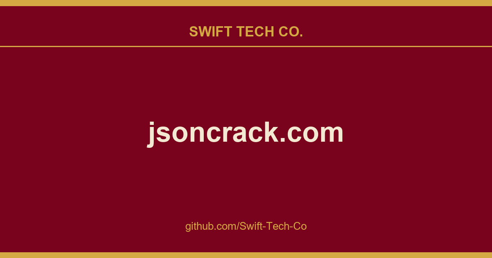
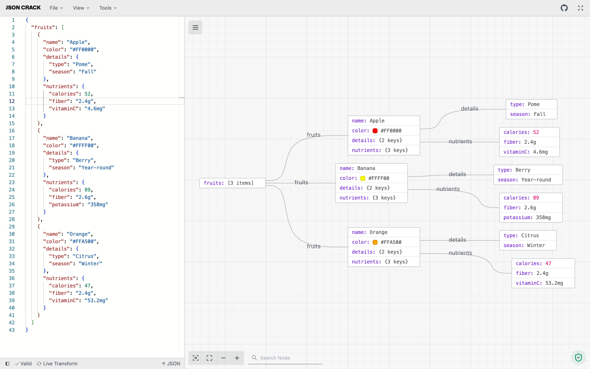

# jsoncrack.com

## What This Is

Every project needs a shelf of ready answers. product and engineering is one of those shelves, and jsoncrack.com is the entry on it - the notes, patterns and fixes we reuse when this kind of work comes up.

## Images

[](https://github.com/Swift-Tech-Co/jsoncrack.com)

## About the Project



## Visualize JSON into interactive graphs

JSON Crack is a tool for visualizing JSON data in a structured, interactive graphs, making it easier to explore, format, and validate JSON. It offers features like converting JSON to other formats (CSV, YAML), generating JSON Schema, executing queries, and exporting visualizations as images. Designed for both readability and usability.

* **Visualizer**: Instantly convert JSON, YAML, CSV, and XML into interactive graphs or trees in dark or light mode.
* **Convert**: Seamlessly transform data formats, like JSON to CSV or XML to JSON, for easy sharing.
* **Format & Validate**: Beautify and validate JSON, YAML, and CSV for clear and accurate data.
* **Code Generation**: Generate TypeScript interfaces, Golang structs, Kotlin data classes, Rust serde types, and JSON Schema.
* **JSON Schema**: Create and validate JSON Schema.
* **Advanced Tools**: Run jq and JSON path queries.
* **Export Image**: Download your visualization as PNG, JPEG, or SVG.
* **Privacy**: All data processing is local; nothing is stored on our servers.

## Recognition

<a href="https://github.com/Swift-Tech-Co/jsoncrack.com">
  
</a>

<a href="https://github.com/Swift-Tech-Co/jsoncrack.com" target="_blank"></a>

## Integrations

- VS Code Extension
- Chrome Extension
- npm Package (`jsoncrack-react`)

## Contributing

- Found a bug or missing feature? Open an issue on GitHub Issues.
- Want to contribute code or docs? Start with our [contribution guide](./CONTRIBUTING.md).

## Stay Up-to-Date

JSON Crack officially launched as v1.0 on the 17th of February 2022 and we've come a long way so far. Watch **releases** of this repository to be notified of future updates:

<a href="https://github.com/Swift-Tech-Co/jsoncrack.com"></a>

<!-- GETTING STARTED -->

## Getting Started

To get a local copy up and running, please follow these simple steps.

### Prerequisites

Here is what you need to be able to run JSON Crack.

- Node.js (Version: >=24.x)
- pnpm (Version: >=10)

## Development

### Setup

1. Clone the repo into a public GitHub repository (or fork https://github.com/Swift-Tech-Co/jsoncrack.com). If you plan to distribute the code, read the [`LICENSE`](/LICENSE.md) for additional details.

   ```sh
   git clone https://github.com/Swift-Tech-Co/jsoncrack.com
   ```

2. Go to the project folder

   ```sh
   cd jsoncrack.com
   ```

3. Install packages

   ```sh
   pnpm install
   ```

4. Run the web app

   ```sh
   pnpm dev:www

   # Running on https://github.com/Swift-Tech-Co/jsoncrack.com
   ```

### Useful Commands

From repository root:

```sh

## Configuration

The supported node limit can be changed by editing `NEXT_PUBLIC_NODE_LIMIT` in `apps/www/.env`.

<!-- LICENSE -->

## License

See [`LICENSE`](/LICENSE.md) for more information.

---

## Swift Tech Co.

Built and maintained by Swift Tech Co.

AI Automation | FinTech Platforms | Custom Software and Mobile Apps | SaaS Platforms | Cloud Infrastructure | Cybersecurity | SEO and Marketing | API Integration

**Join our community on Telegram:** [t.me/+Qt_eFvkb2rliMzNh](https://t.me/+Qt_eFvkb2rliMzNh)

Home | Services | Careers | Referral Program | Influencers | About | Contact

**Connect**

- Website: https://github.com/Swift-Tech-Co/jsoncrack.com
- LinkedIn: [linkedin.com/in/stephenoladoke](https://www.linkedin.com/in/stephenoladoke/)
- LinkedIn (Company): [linkedin.com/company/swift-tech-co](https://www.linkedin.com/company/swift-tech-co)
- X: [@MrOladoke](https://x.com/MrOladoke)
- Instagram: [@mr.oladoke](https://www.instagram.com/mr.oladoke/)
- Instagram (Company): [@swifttechco](https://www.instagram.com/swifttechco/)
- Organization: [github.com/Swift-Tech-Co](https://github.com/Swift-Tech-Co)

## Sources

Compiled and maintained from upstream [AykutSarac/jsoncrack.com](https://github.com/AykutSarac/jsoncrack.com) under permissive open-source license.

---

Maintained by [Swift Tech Co.](https://github.com/Swift-Tech-Co) - [Telegram](https://t.me/+Qt_eFvkb2rliMzNh)

## Sources

Compiled and maintained from upstream [AykutSarac/jsoncrack.com](https://github.com/AykutSarac/jsoncrack.com) under permissive open-source license.

---

Maintained by [Swift Tech Co.](https://github.com/Swift-Tech-Co) - [Telegram](https://t.me/+Qt_eFvkb2rliMzNh)